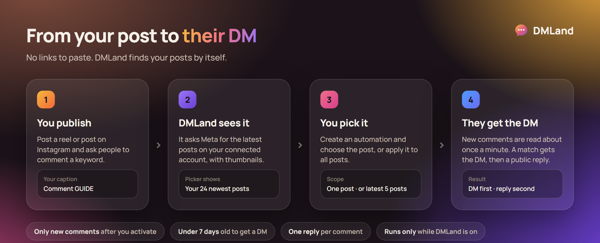

# Posts and automations: how DMLand finds your posts

  

You never paste a post link into DMLand. It finds your posts by itself, and you pick the one you want from a list.

## How the posts get into DMLand

When you connect an Instagram account or a Facebook Page, DMLand uses your own Meta app and token to ask the Meta Graph API for its recent posts. Meta does not push this information to DMLand. DMLand asks for it, and the answer is the list with thumbnails you see in the editor.

## Create an automation, step by step

1. Publish your reel or post on Instagram and ask people to comment a keyword, for example "Comment GUIDE".
2. In DMLand, open **Automations** and click **New automation**.
3. Give it a name, and pick the **Account** if you have connected more than one.
4. In step 1 (**Reel**), pick the scope:
   - **One specific reel or post**: choose it from the thumbnails. The picker shows your **24 most recent** posts.
   - **All posts and reels**: the automation answers on your **latest 5 posts**. Older posts are not watched.
5. In step 2, type the keyword. Then choose what is sent by DM (the link directly, or ask for the email first) and write the public replies. On Instagram you can also tick **Ask people to follow me before sending the resource** (see [HOW-IT-WORKS](HOW-IT-WORKS.md#ask-for-a-follow-first-instagram)).
6. Save and activate it.

Create the automation soon after you publish. Your newest post is always at the top of the list.

## What happens next

- DMLand reads new comments about **once a minute**.
- A comment that matches the keyword gets the **DM first**, then a **public reply** under the comment.
- It only answers comments posted **after** you activated the automation. Older comments are ignored.
- Meta only allows a DM for comments **under 7 days old**.
- One comment is answered **once**, never twice.
- DMLand only works while your computer and the program are on. If it was off, it catches up on the comments when you start it again, as long as they are under 7 days old.

## Good to know

- **Posts older than your 24 newest** do not appear in the picker, so you cannot target them one by one.
- **Carousels**: DMLand does not filter by post type, so comments on carousels should work the same way, but this has not been tested yet.
- **Facebook Pages**: DMLand lists the Page's 24 most recent posts and reels and answers top-level comments only (not replies to other comments). A reel that Facebook also shows as a post appears once, since both share the same comments. The DM arrives in Messenger.
- **Many posts**: you do not need an automation per post. One automation with **All posts and reels** covers your latest 5 at once.

## Automating it further

Creating the automation by hand takes about 30 seconds per post. If you publish through your own tools, you can script the creation yourself. DMLand keeps its data in SQLite and exposes its dashboard API, so this is possible, but it is not part of the project.

More detail on limits and safety: [How DMLand works](HOW-IT-WORKS.md).
